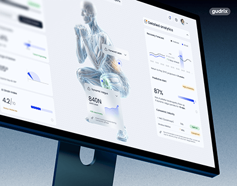

# Sports-analytics dashboard with a translucent 3D athlete model, fatigue gauges and a right panel of forecasts, on a tilted blue monitor

**Discipline:** app ·  · **Design style:** Corporate & Clean-Tech
**Tags:** dashboard, sports, 3d-anatomy, light-ui, blue, gauges, monitor, health

## What it is
A blue monitor tilted in perspective showing a light dashboard with a large glassy anatomical model of a crouching athlete, floating metric cards (840N dynamic fatigue), left tiles with dials and progress bars, and a right 'Detailed analytics' panel with recovery forecast lines, an 87% predictive alert and status chips, with a small logo pill.

## What it means
Scientific and refined; the glass body model makes data feel physical.

## Techniques
- Place a translucent 3D body at the centre.
- Attach metric callouts to body parts.
- Show dials and lines in side panels.
- Use a pale UI on a dark blue monitor.

## Best for
- Sports science and health analytics
- 3D-model-led dashboards
- Medical data UIs

## Vocabulary
- **Anatomical model** — A 3D figure showing body structures.
- **Metric callout** — A card linked to a part of an object.
- **Recovery forecast** — A chart predicting recovery.
- **Predictive alert** — A high-risk percentage with a status chip.
