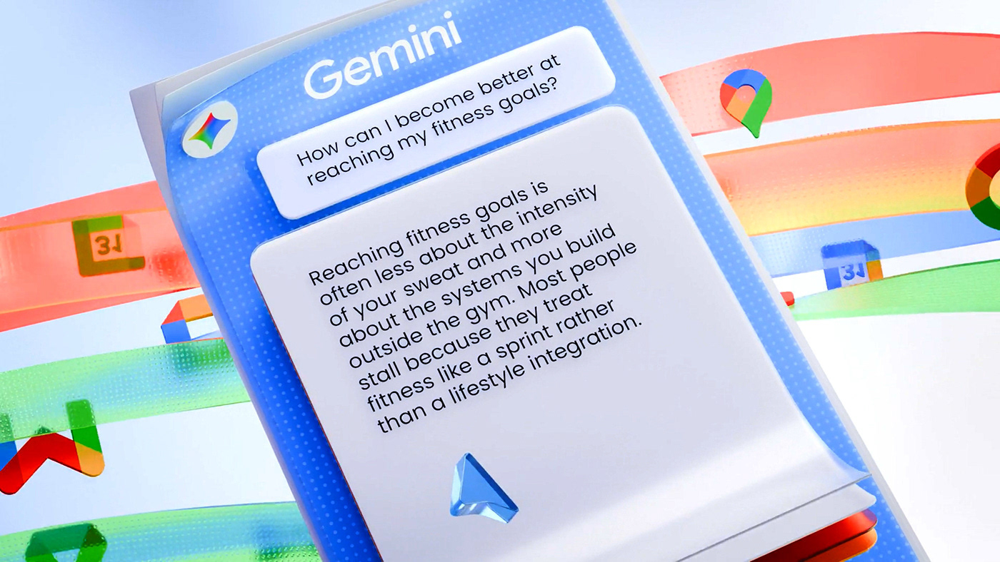

# Frosted chat card tilted in space with translucent rainbow ribbons and app icons

**Discipline:** app ·  · **Design style:** Glassmorphism
**Tags:** 3d, ai-chat, glass, blue, ribbons, app-icons, dotted-texture, motion-frame

## What it is
A close-up 3D scene of a translucent blue panel labelled Gemini with a question bubble and long answer card, tilted in perspective, while red, orange and green glass ribbons with small app icons sweep behind it.

## What it means
Playful and futuristic; the glassy layers make an AI chat feel like a physical object.

## Techniques
- Render UI cards as thick frosted glass with dotted texture.
- Weave translucent ribbons around the interface.
- Tilt the panel for dramatic perspective.
- Colour the ribbons in a brand palette.

## Best for
- AI product motion and launch visuals
- 3D interface concepts
- Brand-colour showcase scenes

## Vocabulary
- **Frosted 3D card** — A thick translucent card in a 3D scene.
- **Ribbon flow** — Ribbons that guide the eye through a scene.
- **Dot texture** — A fine dotted pattern on a surface.
- **Launch visual** — Key art for a product announcement.
