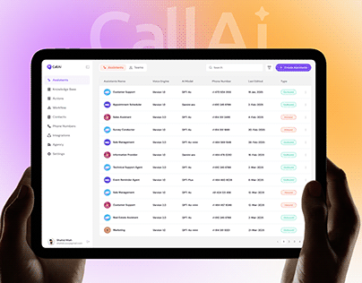

# Voice-assistant admin table on a tablet held in two dark hands over a purple-orange glow and ghost CallAi

**Discipline:** app · **Design type:** Device mockup scene
**Tags:** dashboard, tablet, table, purple, orange, glow, hands, ghost-wordmark

## What it is
Two dark hands hold a black-bezel tablet showing a light admin table of assistants with status pills and a purple Create button, over a violet-to-peach gradient with a faint giant 'CallAi' wordmark.

## What it means
Approachable tech; a warm glow softens a dense table.

## Techniques
- Hold the tablet from both sides for scale.
- Use a violet-orange gradient backdrop.
- Set a ghost wordmark behind.
- Keep the table light and tidy.

## Best for
- SaaS admin dashboard covers
- AI voice products
- Tablet mockups

## Vocabulary
- **Two-hand hold** — A device held by both hands.
- **Gradient glow backdrop** — A warm colour blend behind a device.
- **Ghost wordmark** — A faint large brand name.
- **Admin table** — A data table for managing items.
