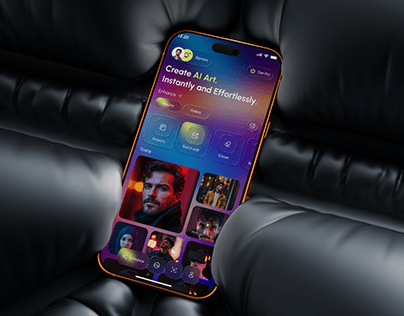

# AI Art App on Black Leather Cushions

**Discipline:** app · **Design type:** Device mockup scene
**Tags:** ai-art, dark, leather, orange, gradient, photos, cover

## What it is
A phone with an orange rim resting on glossy black quilted leather cushions, showing a dark purple and blue AI art app with a headline and a grid of dramatic portraits.

## What it means
Glossy black leather gives a luxurious dark stage, and the orange rim adds a hot edge.

## Techniques
- Glossy black leather as a stage
- Orange bezel as the only warm accent
- Colourful AI portraits glowing on dark UI
- Phone sunk into the cushions
- Gradient buttons in blue and violet

## Best for
- Creative and AI apps
- Dark luxurious covers
- Product staging with tactile materials

## Vocabulary
- **Quilted leather** — Padded, stitched leather with a soft glossy surface.
- **Rim accent** — A coloured edge on a device that adds contrast.
- **Dark stage** — A dark scene that makes bright UI glow.
