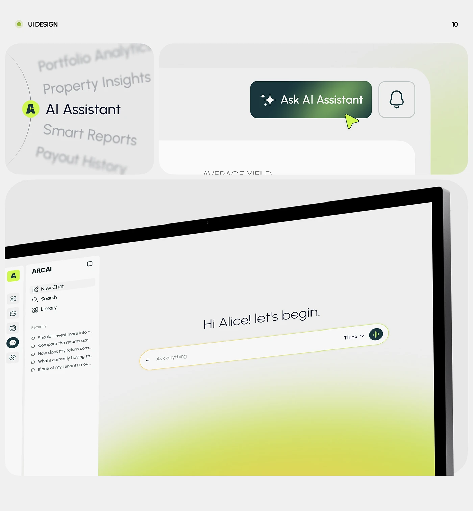

# Blurred nav list with a lime avatar, a dark gradient AI button and a tilted monitor with lime-yellow glow

**Discipline:** app · **Design type:** Interaction showcase
**Tags:** ai, interaction, light-grey, lime, dark-green, blur, monitor, cursor

## What it is
A light grey board titled UI Design with three rounded panels: a vertical menu where the active AI Assistant item is sharp with a lime icon and neighbours blur out; a dark green gradient 'Ask AI Assistant' button with sparkles and a lime cursor beside a bell; and a large tilted monitor showing a chat home 'Hi Alice! let's begin.' with a yellow-outlined prompt bar and a lime-yellow glow rising from the bottom.

## What it means
Refined and alive; blur focus and glow show attention and intelligence.

## Techniques
- Blur non-active menu items to focus the active one.
- Use a dark green to lime gradient on the AI button.
- Outline the prompt bar with a thin yellow glow.
- Tilt the monitor with a bottom colour bloom.

## Best for
- AI assistant interface showcases
- Interaction micro-states
- Lime and dark green brands

## Vocabulary
- **Focus blur** — Blurring neighbouring items to highlight the active one.
- **Glow outline** — A thin luminous border on an input.
- **Bottom bloom** — A colour glow rising from the bottom of a screen.
- **Cursor accent** — A coloured pointer used as decoration.
