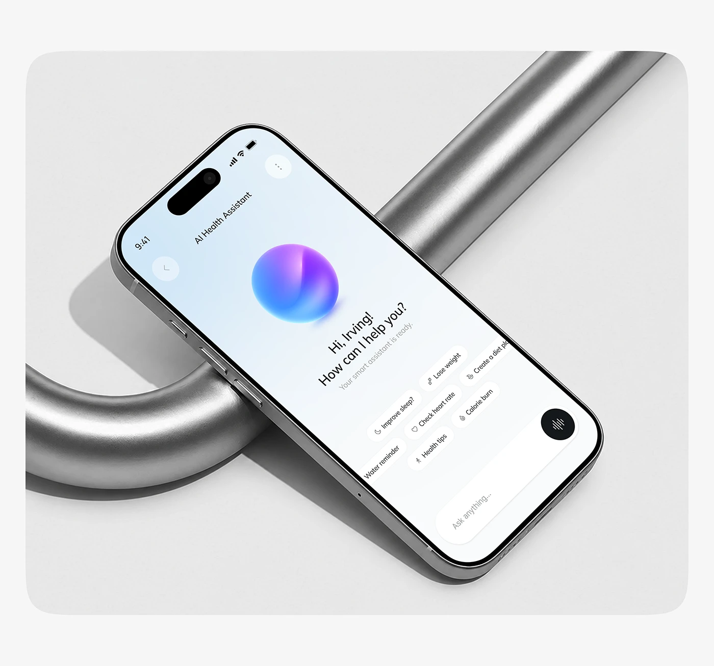

# AI Health Assistant on a Chrome Pipe

**Discipline:** app · **Design type:** Device mockup scene
**Tags:** ai-assistant, orb, chrome, pipe, grey, rounded-panel, chips

## What it is
A rounded grey panel with a phone lying diagonally across a thick chrome pipe, showing an AI health assistant with a gradient orb, greeting, suggestion chips and an ask field with a black voice button.

## What it means
The glossy orb and chrome pipe share a shiny language, and the neutral scene keeps the orb the star.

## Techniques
- Phone resting across a curved metal pipe
- Gradient orb as the assistant's face
- Scattered suggestion chips in a diagonal band
- Soft grey studio panel
- Black voice button as the only dark element

## Best for
- AI assistant apps
- Product renders with metal props
- Neutral premium mockups

## Vocabulary
- **Suggestion chip** — A tappable pill offering a prompt idea.
- **Assistant orb** — A glossy sphere representing an AI assistant.
- **Studio panel** — A rounded frame holding a rendered scene.
