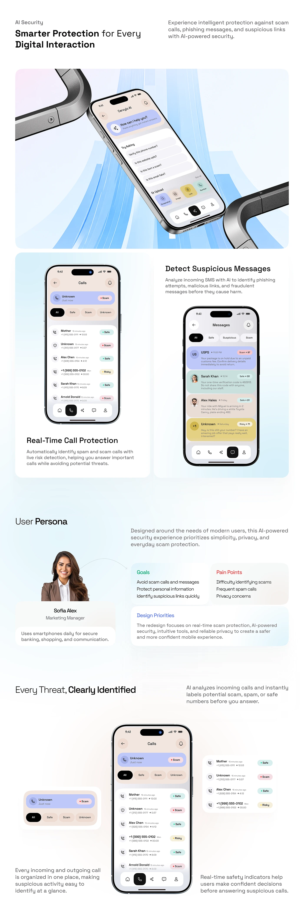

# Scam Protection Features and Persona Sheet

**Discipline:** app ·  · **Design style:** 3D & Surreal
**Tags:** security, long-scroll, pastel, persona, features, phones, chrome

## What it is
A tall pale sheet with an AI Security heading, a hero tile of a phone between chrome brackets over blue ribbons, two feature tiles for call and message protection, a persona block with goals, pain points and priorities, and a closing section of call screens with captions.

## What it means
Alternating hero renders, feature tiles and a persona block build a complete story in a calm pastel system.

## Techniques
- Hero tile with chrome props and blue ribbons
- Feature tiles with device and short caption
- Persona portrait beside coloured goal and pain cards
- Zoomed component beside the full screen
- Consistent pastel colour-coded call and message rows

## Best for
- AI and security app case studies
- Long-scroll feature explanations
- Pastel UI systems

## Vocabulary
- **Feature tile** — A tile explaining one feature with a device and caption.
- **Persona block** — A section showing a user's goals and pain points.
- **Colour-coded status** — Pills using green, red and yellow to show safe, scam and risky.
