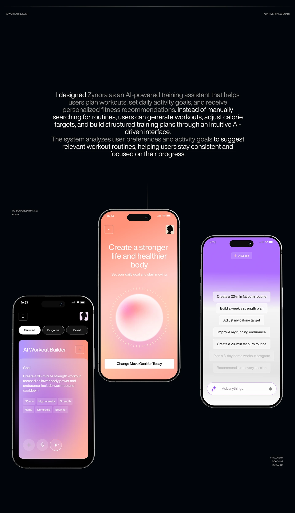

# AI workout builder on black with peach and violet gradient screens

**Discipline:** app ·  · **Design style:** Gradient & Aurora
**Tags:** ai, fitness, dark, gradient, orb, suggestion-list, phones, case-study

## What it is
A near-black board with a centred paragraph in two-tone type and three phones: a dark screen with a lilac to peach AI card, a peach gradient screen with a glowing orb and 'Create a stronger life', and a violet to white chat screen with fading suggestion lines and an 'Ask anything' pill.

## What it means
Futuristic yet warm; gradients give the AI a soft personality.

## Techniques
- Give each screen its own gradient (peach, violet) on a black presentation to make them glow.
- Use a soft glass orb as the emblem of an AI.
- Let suggestion prompts fade out towards the bottom to imply scroll and depth.
- Place tags as small pills inside a gradient card.

## Best for
- AI assistants and coaching apps
- Dark portfolio case studies
- Wellness with a premium tone

## Vocabulary
- **Gradient screen** — A screen using a full-bleed colour gradient as background.
- **Fade-out list** — A list whose items fade toward an edge.
- **AI emblem** — A recurring shape that represents the assistant.
- **Input pill** — A rounded text field with an icon.
