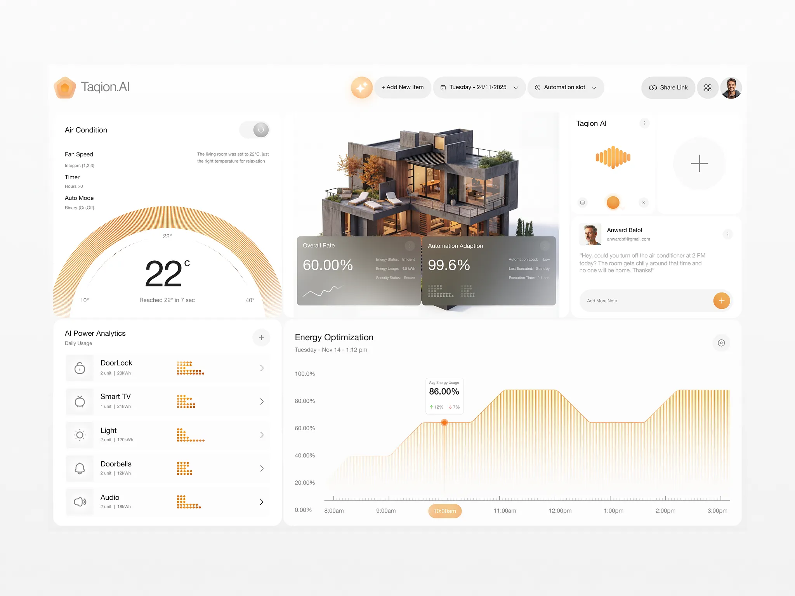

# Smart-home AI dashboard in amber with radial gauge and 3D house

**Discipline:** app · **Design type:** Dashboard
**Tags:** dashboard, smart-home, amber, white, radial-gauge, dotted-charts, 3d-render, glass-card

## What it is
A pale, near-white desktop dashboard with an amber accent. A half-ring gauge of fine lines shows 22°C, a 3D cutaway house sits centre with frosted grey stat cards, a voice waveform card and message card are on the right, a device list has dot-matrix bars, and a line-hatched area chart shows energy use.

## What it means
Calm, high-end and technological; the warm amber makes home data feel comforting instead of clinical.

## Techniques
- Draw gauges and area charts with many fine parallel lines instead of solid fills.
- Use dot-matrix mini bars as compact data glyphs.
- Anchor the layout on a photoreal 3D object with translucent info cards laid over it.
- Keep a single warm hue on a white surface with soft shadows.
- Give a voice-assistant card its own waveform graphic.

## Best for
- Smart-home and IoT control panels
- Energy and analytics dashboards
- AI assistant products with physical objects

## Vocabulary
- **Line-hatch fill** — A fill made from many thin parallel lines.
- **Dot-matrix glyph** — A tiny chart drawn with a grid of dots.
- **Cutaway render** — A 3D model showing the interior of a building.
- **Frosted stat card** — A translucent card with a large metric.
