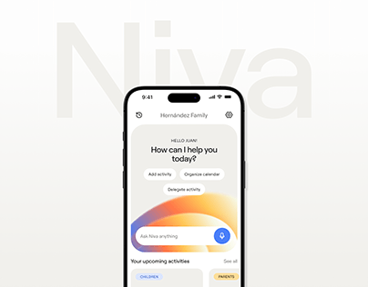

# Home-assistant app screen with a gradient arc over a huge pale 'Niva' wordmark

**Discipline:** app · **Design type:** Device mockup scene
**Tags:** assistant, ai, cream, gradient-arc, ghost-wordmark, project-cover, chips, minimal

## What it is
A cream cover with a giant pale 'Niva' behind a phone showing a greeting, a question 'How can I help you today?', action chips and an input with an orange-blue gradient arc and a blue mic button.

## What it means
Warm and calm; the ghost name and glowing arc make an assistant feel gentle.

## Techniques
- Set a huge low-contrast wordmark behind the phone.
- Use a warm gradient arc as the AI glow.
- Present actions as small white chips.
- Keep the cover monochrome cream.

## Best for
- AI assistant project covers
- Household and family apps
- Minimal cream presentations

## Vocabulary
- **Ghost wordmark** — A large faint name behind content.
- **Gradient arc** — A curved blurred glow near the input.
- **Action chip** — A small pill for a suggested action.
- **Cream cover** — A soft neutral background.
