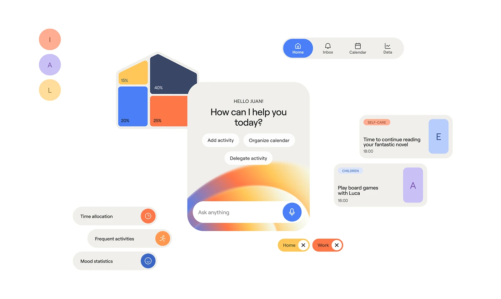

# Floating assistant components: nav pill, house-shaped chart, greeting card with gradient arc, chips, task cards and settings rows

**Discipline:** app · **Design type:** UI components
**Tags:** ui-kit, components, white, orange, blue, chart, chips, assistant

## What it is
A white canvas with scattered components: a pill tab bar with a blue selected Home, a house-shaped tile chart in yellow, navy, blue and orange with percentages, a central card 'How can I help you today?' with chips and a gradient arc input, coloured letter avatars, event cards with category tags and letter tiles, toggle chips (Home, Work) and rows for time allocation, frequent activities and mood statistics with round icons.

## What it means
Cheerful and organised; a component cloud shows the whole system at once.

## Techniques
- Scatter components on white as a system overview.
- Use a house-shaped chart for a family app.
- Give each category a colour.
- Use round icons on grey rows.

## Best for
- UI kit and component overviews
- Family and planner apps
- Colour-coded systems

## Vocabulary
- **Component cloud** — UI parts scattered across a canvas.
- **Shape chart** — A chart shaped like an object such as a house.
- **Letter tile** — A tile with a single letter as an icon.
- **Toggle chip** — A pill with a close or switch control.
