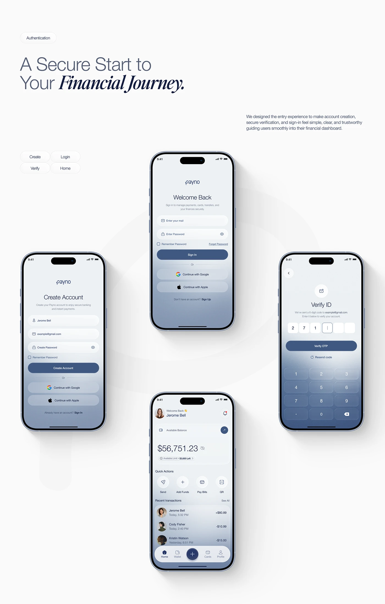

# Login, create-account, OTP and home screens with pale-to-slate gradient bottoms

**Discipline:** app · **Design type:** Onboarding screens
**Tags:** authentication, fintech, gradient, slate-blue, otp, keypad, white, italic-serif

## What it is
An off-white page with a light and italic serif headline and four tilted-perspective phones arranged like a cross: welcome back, create account, OTP verification with a keypad, and home with balance. Each screen fades from near-white to slate blue at the bottom.

## What it means
Secure and calm; the fade toward blue suggests depth and trust.

## Techniques
- Fade screens from white to slate at the bottom.
- Arrange four screens in a cross around a centre.
- Show OTP boxes and a translucent keypad.
- Use small pill tabs to name each screen.

## Best for
- Authentication flow case studies
- Fintech UI presentations
- Gradient-bottom mobile screens

## Vocabulary
- **Bottom fade** — A gradient darkening toward the screen bottom.
- **OTP field** — Boxes for entering a one-time code.
- **Cross layout** — Four items placed around a centre.
- **Flow tabs** — Small pills naming each step.
