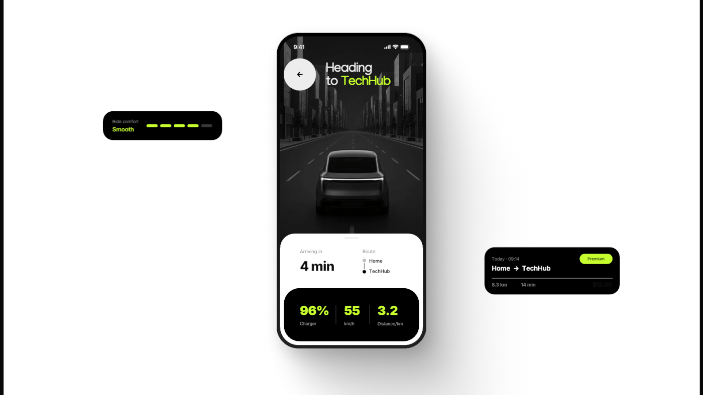

# Ride-progress screen with dark road photo, stat panel and floating chips

**Discipline:** app · **Design type:** Ride-hailing app
**Tags:** mobility, dark-photo, lime, black, stats, route, chips, white-stage

## What it is
A white stage with a phone centre: a dark monochrome road photo with a car from behind and 'Heading to TechHub' in white with lime accent; a white bottom sheet with arrival time and route; a black stat block with lime numbers for charge, speed and distance. Two black chips float outside: a lime-bar ride comfort meter and a trip summary with Premium tag.

## What it means
Sleek and reassuring; lime numerals on black communicate precision and control.

## Techniques
- Use a monochrome photo header with a single lime word.
- Put stats in a black rounded block with lime numerals.
- Float small feature chips beside the phone to explain details.
- Use segmented lime bars as a comfort meter.

## Best for
- Mobility and vehicle apps
- Feature explainers with floating callouts
- Black, white and neon brands

## Vocabulary
- **Segmented meter** — A bar divided into small lit segments.
- **Floating chip** — A small UI card placed outside the device.
- **Stat block** — A dark container with several figures.
- **Monochrome header** — A greyscale photo at the top of a screen.
