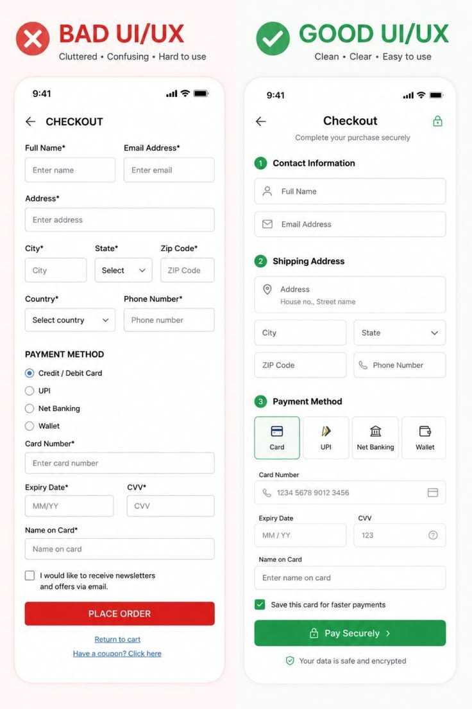

# Bad versus Good Checkout UI Comparison

**Discipline:** app ·  · **Design style:** Geometric & Bauhaus
**Tags:** checkout, comparison, forms, red-green, before-after, education, payment

## What it is
A split image comparing a cluttered checkout with a red cross and a red Place Order button against a clean checkout with a green tick, numbered sections, icons on fields, payment method tiles and a green Pay Securely button.

## What it means
Side-by-side before and after with red and green makes the lesson obvious, and grouping and icons show what better looks like.

## Techniques
- Before and after split with red and green headers
- Numbered sections with green circles
- Payment method tiles with icons
- Fields with leading icons
- Single strong primary button

## Best for
- UX education comparisons
- Checkout and form design
- Before and after posts

## Vocabulary
- **Before/after split** — Two versions of a design shown side by side.
- **Grouped form** — Fields organised under numbered headings.
- **Primary action** — The main coloured button of a screen.
