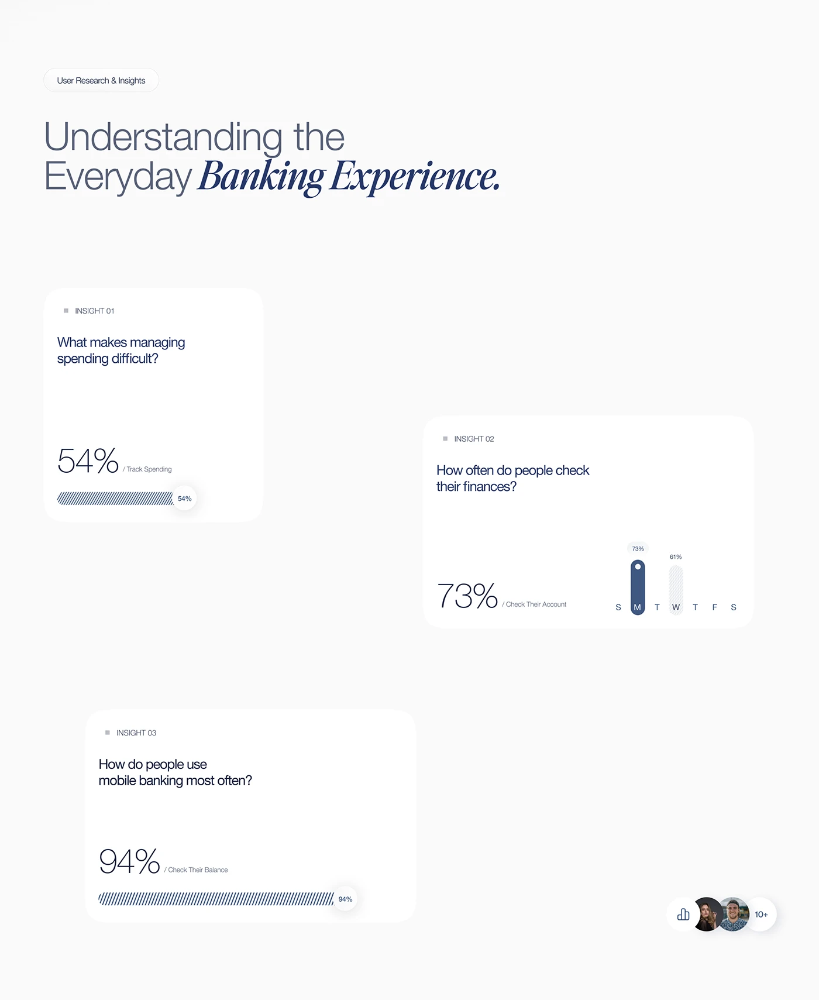

# Banking Research Insight Cards

**Discipline:** app · **Design type:** Research insight slide
**Tags:** research, data, navy, serif-italic, cards, stats, minimal

## What it is
A pale case-study slide with a light sans and navy italic serif headline, and three staggered white cards each posing a question with a giant percentage and a hatched progress bar or day chart.

## What it means
Big light numerals and hatched bars make data feel elegant and calm. The stagger keeps a simple slide from feeling like a table.

## Techniques
- Mixing a light sans with an italic serif in one headline
- Oversized thin numerals paired with tiny captions
- Hatched bar fills with a floating percentage bubble
- Cards staggered at different heights and offsets
- Single navy hue for all data

## Best for
- UX research summaries
- Case study insight slides
- Fintech and banking presentations

## Vocabulary
- **Hatched fill** — A bar filled with fine diagonal or vertical lines instead of solid color.
- **Type mix** — Combining different typeface styles within one headline.
- **Stat card** — A card built around one big number and its caption.
