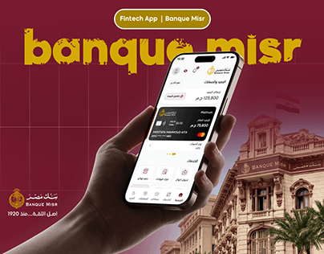

# Banque Misr fintech app: hand holding the banking app over the historic bank building on maroon

**Discipline:** app · **Design type:** Fintech app screens · **Design style:** Corporate & Clean-Tech
**Tags:** banking, arabic, maroon, gold, hand-mockup, heritage

## What it is
A maroon cover with grunge-textured gold 'banque misr' letters, a 'Fintech App | Banque Misr' pill, a hand holding a phone with an Arabic banking home (card, balance, services), the bank's historic building and flag in the corner and the gold logo with 'since 1920'.

## What it means
Heritage meets digital; the old building beside a new app says trusted but modern.

## Techniques
- Pair the product with a heritage landmark photo.
- Use a grunge texture on the brand name for character.
- Stick to the bank's maroon and gold.

## Best for
- Bank app redesigns
- Heritage brands going digital
- Arabic fintech

## Vocabulary
- **Heritage cue** — A visual that signals a brand's long history.
- **Grunge texture** — A rough, worn surface effect on type.
