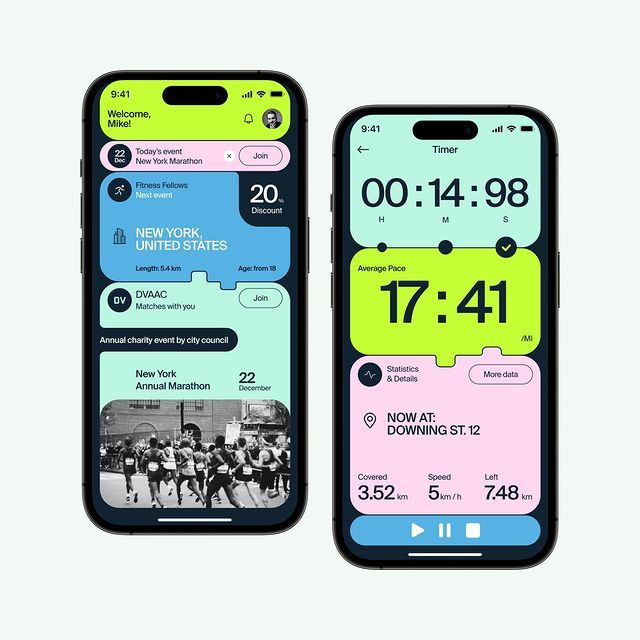

# Colour-Block Bento Marathon App

**Discipline:** app · **Design type:** Fitness app screens
**Tags:** bento, lime, pastel, fitness, cards, timer, rounded

## What it is
Two phone screens for a running-event app on a pale mint backdrop: an event feed and a live timer, both built from interlocking rounded panels in lime, pink, sky blue and mint on a navy shell.

## What it means
Bright color-coded panels make every function instantly distinguishable and feel energetic and sporty. The notched, puzzle-like edges make the interface feel playful and tactile.

## Techniques
- Interlocking notched cards that read like puzzle pieces
- One saturated pastel per function so color itself works as navigation
- Huge tabular numerals for the key metric (pace, timer)
- Dark navy container gaps that act as outlines between the color blocks
- Small pill buttons with outlines as secondary actions

## Best for
- Fitness, sports and event apps
- Youthful consumer apps with a playful tone
- Data-light screens where one number matters

## Vocabulary
- **Bento layout** — A grid of differently sized rounded tiles, each holding one idea.
- **Notched card** — A card whose edge has a tab or cut-out that locks into its neighbour.
- **Hero numeral** — An oversized number that is the focal point of a screen.
