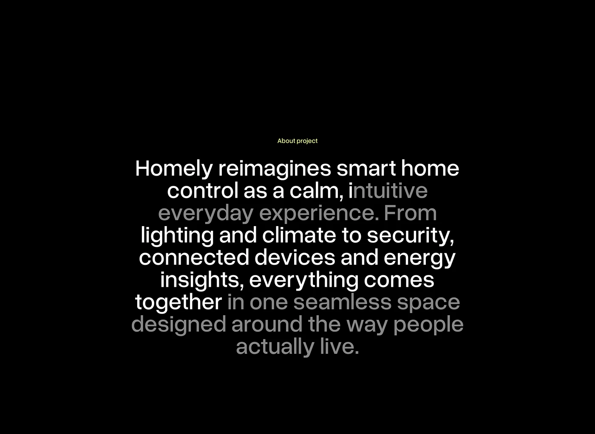

# Black About-Project Fading Text

**Discipline:** app · **Design type:** Case study intro slide
**Tags:** about, black, text-only, fade, centered, grotesk, minimal

## What it is
A black slide with a tiny lime 'About project' label and a large centred paragraph whose words switch between white and grey to create a highlight rhythm.

## What it means
Alternating white and grey text draws attention to key phrases and mimics a scroll-reveal effect, with no imagery needed.

## Techniques
- Selective grey dimming to emphasise phrases
- Centred multi-line statement as the sole element
- Lime micro-label as the only colour
- Generous surrounding black
- Tight-leaded grotesk type

## Best for
- Project descriptions in case studies
- Manifesto or statement slides
- Dark editorial layouts

## Vocabulary
- **Scroll-reveal text** — Text that progressively brightens as it is read.
- **Micro-label** — A very small label naming a section.
- **Statement slide** — A slide made of a single paragraph.
