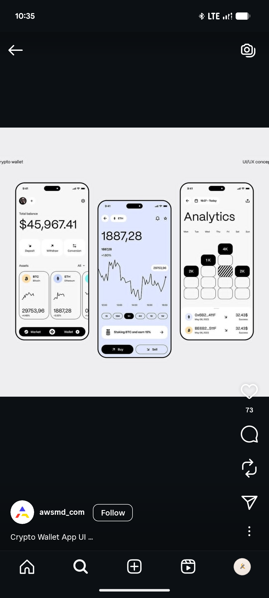

# Black-Outlined Crypto Wallet Concept (Alternate)

**Discipline:** app ·  · **Design style:** Minimalist
**Tags:** crypto, wallet, black-outline, monochrome, periwinkle, analytics, duplicate

## What it is
The same three-phone crypto wallet concept, a white wallet home, a periwinkle asset chart with Buy and Sell, and a checker-grid Analytics page, captured a second time.

## What it means
It repeats the same idea: bold outlines and one tinted screen make a monochrome set feel graphic.

## Techniques
- Thick black device outlines
- Periwinkle accent screen
- Hatched and black grid cells
- Black pill navigation
- Large balance numerals

## Best for
- Crypto concept presentations
- Monochrome UI with one tint
- Grid-based analytics visuals

## Vocabulary
- **Accent screen** — The one screen in a set filled with colour.
- **Grid analytics** — A weekly grid where cell fill shows value.
- **Pill nav** — A rounded bottom navigation bar.
