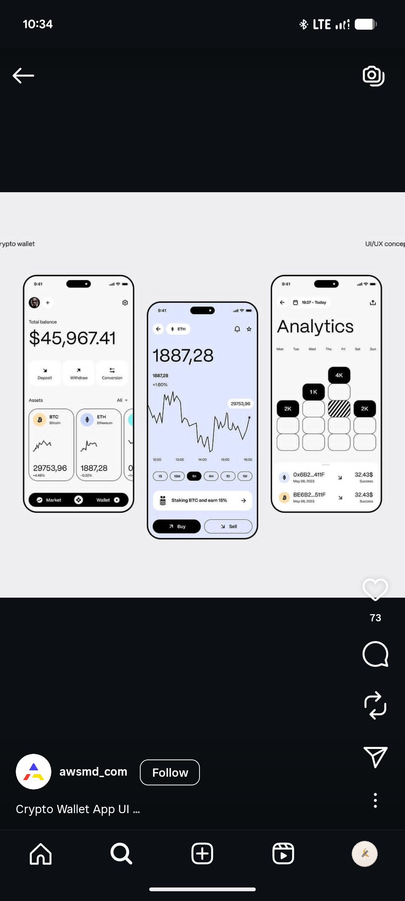

# Black-Outlined Crypto Wallet Concept

**Discipline:** app ·  · **Design style:** Corporate & Clean-Tech
**Tags:** crypto, wallet, black-outline, monochrome, periwinkle, analytics, chart

## What it is
Three phones with thick black bezels on light grey: a white wallet with a big balance, action tiles and asset cards with sparklines and a black Market and Wallet pill; a periwinkle asset page with a jagged line chart, range pills, a staking banner and Buy and Sell buttons; and an Analytics page with a weekday grid of black and hatched cells.

## What it means
Heavy black outlines and a single periwinkle screen give a graphic, poster-like clarity, and the checker grid makes analytics playful.

## Techniques
- Thick black outlines on the devices and controls
- One periwinkle screen among white ones
- Weekday grid cells with black and hatched fills
- Black bottom pill nav
- Big light numerals for balances

## Best for
- Crypto concept presentations
- Monochrome UI with one tint
- Grid-based analytics visuals

## Vocabulary
- **Hatched cell** — A cell filled with diagonal lines to mark a special state.
- **Concept screen** — A design exploration not tied to a live product.
- **Bezel outline** — A thick line used as the device frame.
