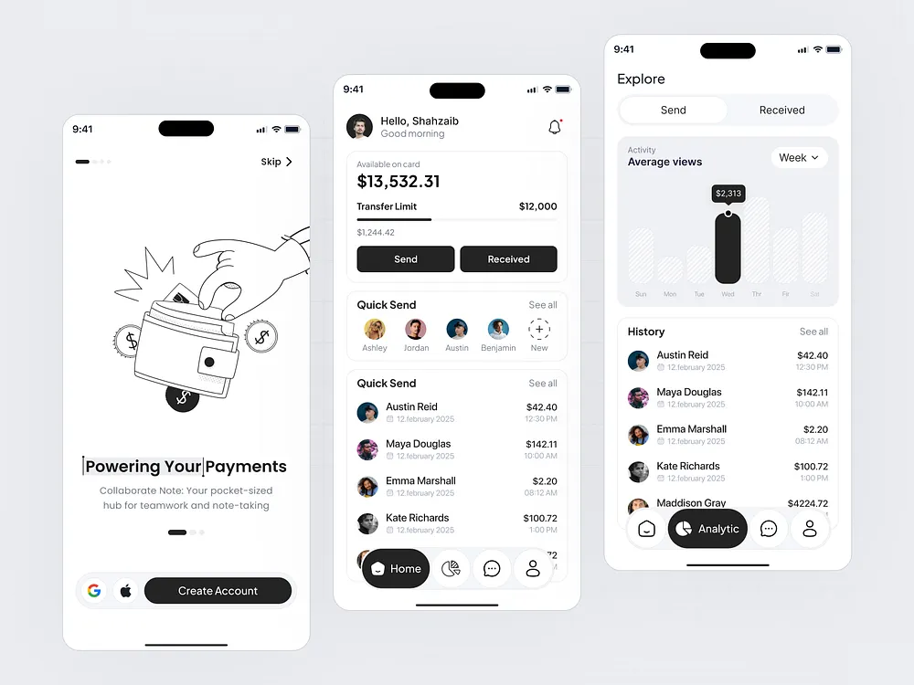

# Black and White Payments App Screens

**Discipline:** app ·  · **Design style:** Playful & Illustrated
**Tags:** payments, monochrome, line-illustration, black, white, tab-bar, chart

## What it is
Three white phones at different heights: an onboarding screen with a hand-drawn line illustration of a hand putting a card in a wallet, a home with balance, transfer limit bar, Send and Received buttons, quick send avatars and a history, and an analytics screen with a hatched bar chart and one solid black bar with a tooltip, all with black pill tab bars.

## What it means
A strict black and white palette with line art feels crisp and editorial, and one solid bar marks the selected value.

## Techniques
- Black line illustration on white
- Hatched bars with one solid black bar
- Black pill tab bar with a white circle active state
- Two black action buttons side by side
- Staggered phone heights

## Best for
- Monochrome fintech UI
- Payment app onboarding
- Illustration plus UI systems

## Vocabulary
- **Line illustration** — A drawing made of outlines without fills.
- **Hatched bar** — A bar filled with fine diagonal lines.
- **Quick send** — A row of recent contacts for fast payment.
