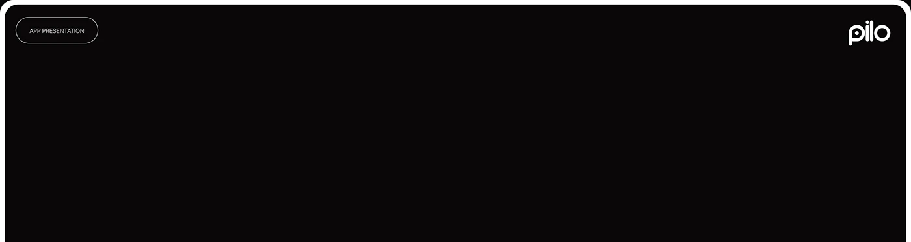

# Black rounded strip with an outlined 'App presentation' pill and white logo

**Discipline:** app · **Design type:** Case study divider
**Tags:** divider, black, pill-tag, logo, minimal, empty-space, case-study

## What it is
A wide black rounded panel with a thin outlined pill 'APP PRESENTATION' at the top left and a white rounded 'pilo' logo at the top right, otherwise empty.

## What it means
A quiet chapter opener; emptiness builds anticipation for what follows.

## Techniques
- Use an outlined pill as a chapter label.
- Place the logo opposite the label.
- Leave the field empty and black.

## Best for
- Case-study section breaks
- Dark presentations
- Reveal frames

## Vocabulary
- **Chapter pill** — An outlined capsule naming a section.
- **Empty canvas** — Deliberately blank space.
- **Corner logo** — A logo placed in a top corner.
- **Divider panel** — A slide that separates sections.
