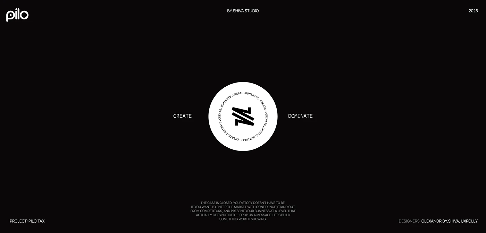

# Black closing slide with a white circular text seal, CREATE and DOMINATE, and credits

**Discipline:** app · **Design type:** Case study closing slide
**Tags:** closing, black, white, circular-text, seal, monospace, credits, minimal

## What it is
A black slide with a white circle holding a black zigzag mark ringed with repeating 'CREATE.DOMINATE.' text, the words CREATE and DOMINATE on each side, a logo at the top left, studio name centred at the top, year at the right, a paragraph at the bottom and project and designer credits at the corners.

## What it means
Confident and final; a seal is a fitting sign-off.

## Techniques
- Ring a symbol with circular monospace text.
- Place words either side.
- Use tiny corner credits.
- Keep the field pure black.

## Best for
- Case-study endings
- Studio sign-offs
- Dark closing slides

## Vocabulary
- **Text seal** — A circular badge with text set around a symbol.
- **Circular monospace** — Monospace text following a ring.
- **Corner credits** — Small text in the four corners.
- **Closing paragraph** — A short call-to-action at the bottom.
