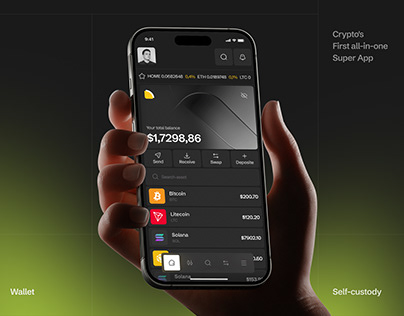

# Crypto Super App in Hand with Lime Glow

**Discipline:** app ·  · **Design style:** Gradient & Aurora
**Tags:** crypto, black, lime, hand, wallet, glow, cover

## What it is
A dark cover with a hand holding a phone showing a black wallet with a large balance, action buttons and coin list, a lime-yellow glow rising from the bottom left, and text lines at the corners about wallet, self-custody and the first all-in-one super app.

## What it means
A lime glow on black feels high-tech and energetic, and corner text frames the hero without clutter.

## Techniques
- Lime glow rising from a corner on black
- Hand lit from the side
- Small captions at the four corners
- Dark UI with coloured coin icons
- Metallic card graphic at the top of the UI

## Best for
- Crypto app covers
- Dark hero mockups
- Glow-accented product shots

## Vocabulary
- **Corner glow** — Coloured light emerging from a frame corner.
- **Corner captions** — Short text placed at the corners of a cover.
- **Coin list** — A list of assets with icons and values.
