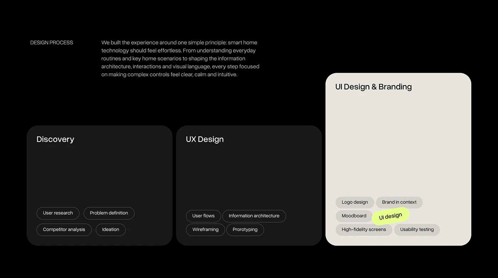

# Black Design Process Cards with Tag Pills

**Discipline:** app ·  · **Design style:** Dark & Neon
**Tags:** process, black, cards, pills, discovery, ux, lime-highlight

## What it is
A black slide with a small label and paragraph, and three tall rounded cards (Discovery, UX Design, UI Design & Branding) each with outlined activity pills at the bottom, the last card cream with a tilted lime pill.

## What it means
Stage cards with tag lists summarise a process compactly, and the pale card marks the final stage.

## Techniques
- Cards with content anchored to the bottom, leaving headroom
- Outlined pills for activities
- One tilted lime pill as a playful highlight
- Inverse (light) card for the finale
- Small caps label and two-line paragraph at top

## Best for
- Design process overviews
- Agency and freelancer case studies
- Any three-stage workflow

## Vocabulary
- **Tag pill** — A rounded label naming an activity.
- **Inverse card** — A card with opposite colours to its neighbours.
- **Bottom-anchored content** — Content pinned to the base of a card.
