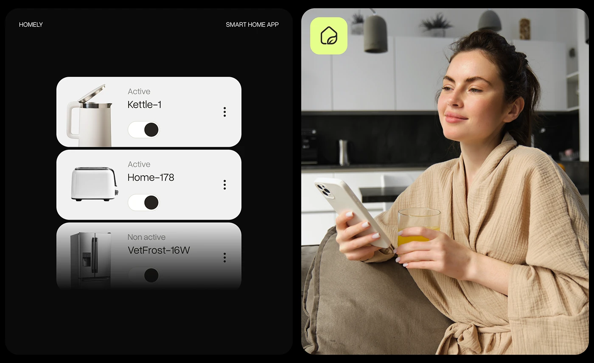

# Device Toggle Cards beside Lifestyle Photo

**Discipline:** app · **Design type:** Device mockup scene
**Tags:** smart-home, black, toggle, cards, fade, lifestyle, lime-icon

## What it is
A split image: a black panel with three stacked white device cards (kettle, toaster, fridge) each with an active or non-active label and a toggle, the last fading into black, and a photo of a woman in a robe with a juice and phone in a kitchen with a lime app icon in the corner.

## What it means
Product images on cards with toggles make control obvious, the fade implies a longer list, and the lifestyle photo gives context.

## Techniques
- Stack of cards with the last one fading out
- Product photo cut-outs inside cards
- Round toggle with a dark knob
- Lime app icon over a photo
- Two panels of equal size

## Best for
- Smart-home device lists
- Lifestyle plus UI presentations
- Toggle card components

## Vocabulary
- **Fading list** — A list whose last item fades to indicate more.
- **Device card** — A card showing an appliance with status and a switch.
- **Diptych** — Two related panels shown side by side.
