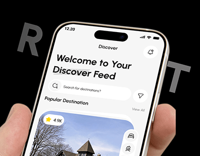

# Discover Feed Phone over Grey Ghost Letters

**Discipline:** app ·  · **Design style:** Dark & Neon
**Tags:** black, discover, hand, ghost-type, travel, cover, white-ui

## What it is
A cover on black with giant grey letters cropped by the phone, a hand holding a white 'Welcome to Your Discover Feed' screen with a search bar and a destination photo card.

## What it means
High contrast between the white UI and black background makes the screen pop, and the cropped letters add depth.

## Techniques
- Ghost lettering partially hidden by the device
- White UI on pure black
- Hand cropped in from the left
- Bold two-line title in the UI
- Tilted device for dynamism

## Best for
- Travel discovery apps
- Dark cover images
- High-contrast mockups

## Vocabulary
- **Cropped lettering** — Large text partially hidden behind another object.
- **Discover feed** — A browsing screen of recommended items.
- **High-contrast cover** — A cover where the subject is brightest against a dark ground.
