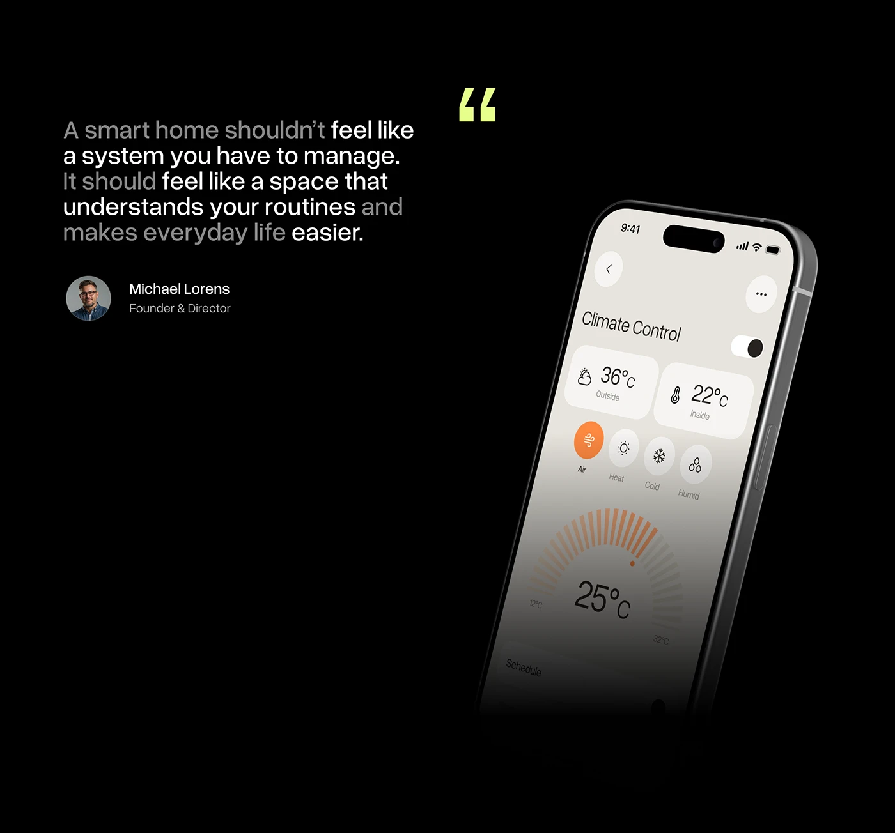

# Founder Quote with Tilted Climate Phone

**Discipline:** app · **Design type:** Case study intro slide
**Tags:** quote, black, lime, tilted-phone, fade, founder, smart-home

## What it is
A black slide with a large quote in alternating white and grey words, a lime quote mark, a founder avatar and title, and a steeply tilted cream climate control phone fading into black at the base.

## What it means
The fading phone and tone-shifting quote create depth, and the lime quote mark is the single accent.

## Techniques
- Words alternating bright and grey in a quote
- Lime quotation mark as an accent
- Phone rotated steeply and faded at the bottom
- Avatar with name and role
- Generous black space

## Best for
- Founder or client quotes
- Dark case-study slides
- Combining testimony with product

## Vocabulary
- **Fade-out device** — A device whose bottom dissolves into the background.
- **Tone-shift quote** — A quotation with words at alternating brightness.
- **Accent quote mark** — A quotation mark in the brand accent colour.
