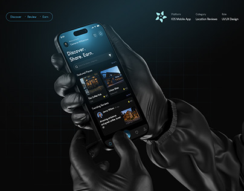

# Gloved Hands Holding Dark Review App

**Discipline:** app ·  · **Design style:** 3D & Surreal
**Tags:** dark, teal, hands, gloves, 3d, reviews, metadata, grid

## What it is
A dark cover with black-gloved hands holding a phone showing a location reviews app with teal highlights, faint grid, and a small meta block (platform, category, role) at top right.

## What it means
Everything is black-on-black with one teal glow, giving a sleek, stealthy, premium feel. The metadata row reads like a spec plate.

## Techniques
- Render hands in the same black as the background so only the glowing screen stands out
- Teal glow as the only colour
- Faint background grid for a technical feel
- Small metadata columns in a corner
- Symmetrical central device

## Best for
- Dark UI portfolio covers
- Discovery and review apps
- Premium tech presentation

## Vocabulary
- **Tone-on-tone** — Using near-identical dark values to hide everything but the focal point.
- **Meta block** — Small labeled fields listing platform, category and role.
- **Screen glow** — Light emanating from a device display.
