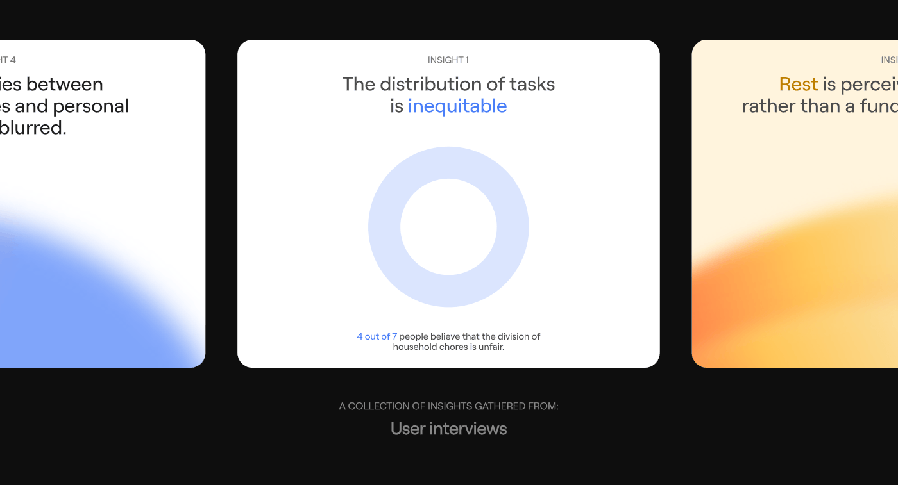

# Insight Cards with Gradient Blobs

**Discipline:** app · **Design type:** Research insight slide
**Tags:** insights, black, cards, gradient, blue, orange, ring-chart

## What it is
A black slide with three rounded cards in a row: a blue-gradient card partly cut off, a white card 'The distribution of tasks is inequitable' with a pale donut, and an orange-yellow gradient card, captioned 'A collection of insights gathered from user interviews'.

## What it means
Colour-coded cards with soft gradient blobs make interview findings feel distinct and memorable. The cropped edges suggest a carousel.

## Techniques
- Cropped side cards implying horizontal scroll
- One blue highlighted phrase in each headline
- Soft gradient blob rising from the card base
- Donut chart as a simple statistic visual
- Muted caption below the row

## Best for
- User interview insight summaries
- Case-study research slides
- Carousel-style presentations

## Vocabulary
- **Insight card** — A card summarising one research finding.
- **Cropped carousel** — Cards cut off at the sides to imply scrolling.
- **Gradient blob** — A soft colour cloud used as background.
