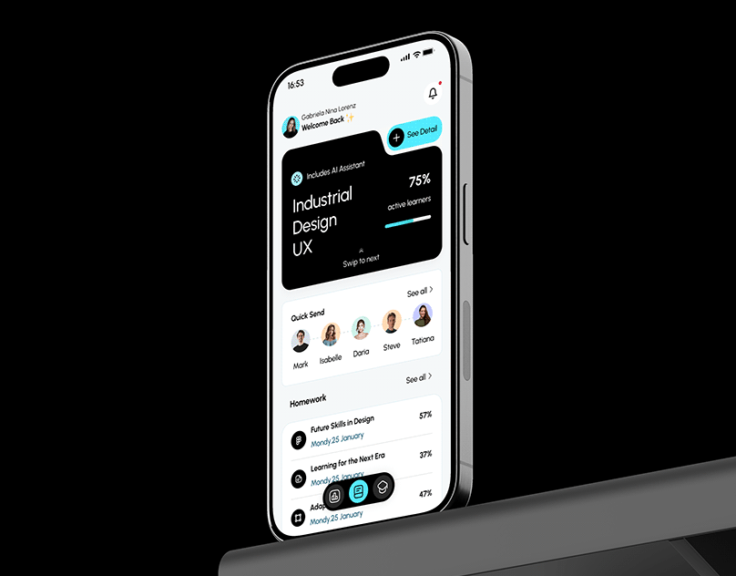

# Learning app on a tilted phone against black, small crop, with a black course card and aqua highlights

**Discipline:** app · **Design type:** Device mockup scene
**Tags:** education, phone, black, aqua, course-card, progress, project-thumbnail, tilted

## What it is
A smaller crop of a tilted silver phone on black showing a white home with a black 'Industrial Design UX' card with 75% and an aqua progress bar, a Quick Send avatar row and a Homework list with percentages and a floating aqua nav.

## What it means
Crisp and modern; a black card and aqua accent give a learning app punch.

## Techniques
- Tilt the phone against pure black.
- Use a black hero card with an aqua bar.
- Show avatars in a Quick Send row.
- Float an aqua pill nav.

## Best for
- Education app project covers
- Black stage mockups
- Aqua-accent apps

## Vocabulary
- **Course card** — A dark card summarising a course with progress.
- **Quick Send row** — A row of avatars for fast actions.
- **Floating nav** — A detached pill navigation.
- **Black stage** — A pure black background.
