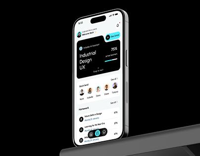

# Learning app on a tilted silver phone against black with a dark shelf edge

**Discipline:** app · **Design type:** Device mockup scene
**Tags:** education, phone, black, aqua, course-card, progress, tilted, shelf

## What it is
A silver phone tilted against black, its screen showing 'Welcome Back', a notched black 'Industrial Design UX' card with a See Detail aqua tab, 75% active learners, Quick Send avatars and a Homework list, with a dark shelf edge at the bottom.

## What it means
Sleek and focused; the notched card is the memorable component.

## Techniques
- Tilt the device in perspective.
- Notch a card corner to hold an action.
- Use aqua for the active tab and bar.
- Let the shelf ground the phone.

## Best for
- Education and course apps
- Dark mockup covers
- Notched card patterns

## Vocabulary
- **Notched card** — A card with a cut corner holding a button.
- **See Detail tab** — A small action tab in the notch.
- **Perspective tilt** — A device angled in space.
- **Dark shelf** — A dark ledge under a floating object.
