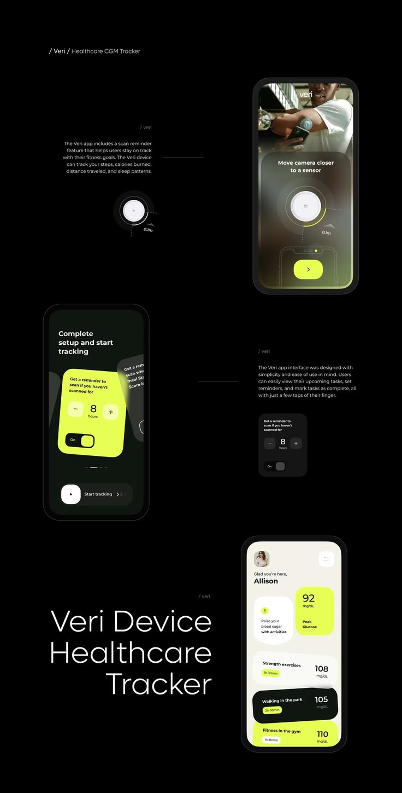

# Black and Lime Glucose Tracker Flow

**Discipline:** app · **Design type:** Health app screens
**Tags:** health, black, lime, tracker, sensor, flow, captions

## What it is
A black page with phones stepping down: a camera scan screen with a sensor ring, a lime reminder card with an hours stepper, and a cream home with tilted lime and dark cards, joined to tiny captions and a large light title 'Veri Device Healthcare Tracker'.

## What it means
Neon lime on black feels clinical yet energetic, and tilted cards add life to numbers.

## Techniques
- Lime as the only accent on black
- Tilted overlapping cards on the home screen
- Camera scan overlay with ring and distance label
- Enlarged component beside its phone
- Big light title in the corner

## Best for
- Health device companion apps
- Dark app flow boards
- Sensor and scan interfaces

## Vocabulary
- **Scan overlay** — A ring and instruction layered over a camera view.
- **Stepper** — A control with minus and plus to change a number.
- **Tilted card stack** — Cards rotated and overlapped for energy.
