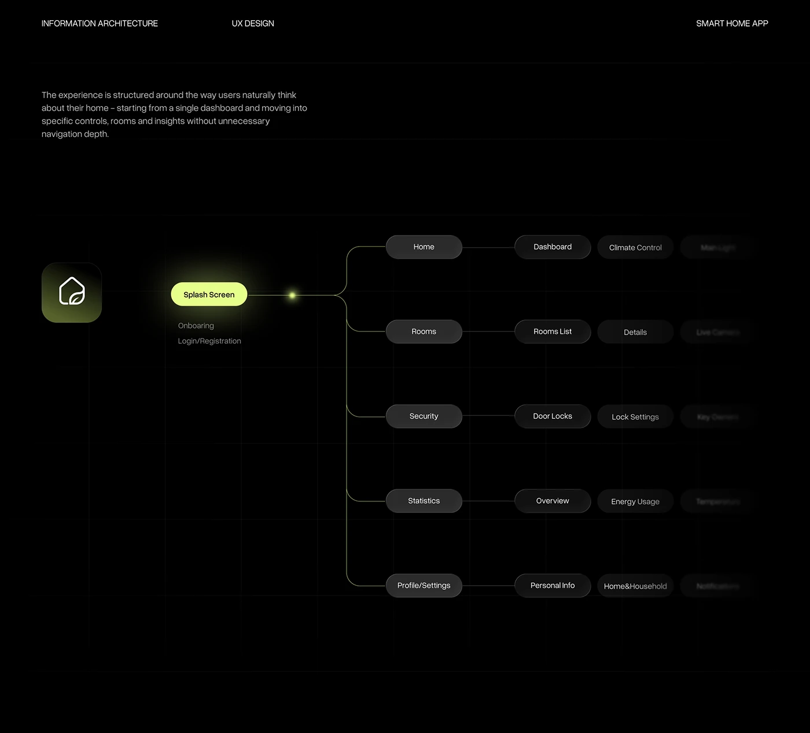

# Black and Lime Information Architecture Tree

**Discipline:** app ·  · **Design style:** Dark & Neon
**Tags:** information-architecture, black, lime, tree, nodes, smart-home, ux

## What it is
A black page with a short intro paragraph and a left-to-right tree: a glowing lime Splash Screen node branching into five dark pill sections (Home, Rooms, Security, Statistics, Profile) and their sub-screens that fade out to the right.

## What it means
The single glowing lime node marks the entry point, and dark grey pills stay quiet. Fading depth communicates 'more inside' without listing everything.

## Techniques
- One lit node with a soft glow as the starting point
- Thin lime connector with a small light dot at the fork
- Progressive fading of deeper levels
- Faint grid lines on black
- App icon at far left as the root

## Best for
- UX architecture and sitemap slides
- Dark-mode case studies
- Explaining navigation depth

## Vocabulary
- **Information architecture** — How an app's content and screens are organised.
- **Root node** — The starting item from which a tree branches.
- **Depth fade** — Reducing opacity for deeper levels of a hierarchy.
