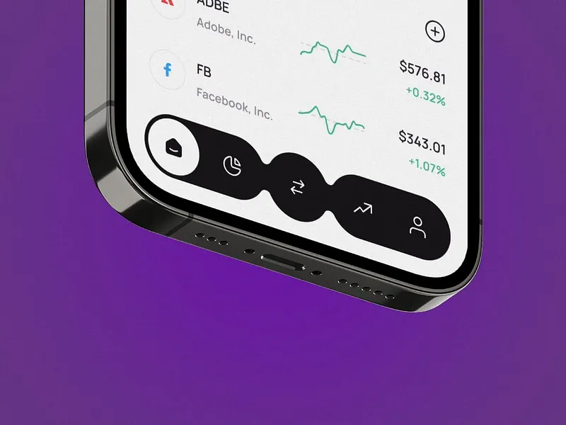

# Black Liquid Blob Tab Bar on Phone Corner

**Discipline:** app · **Design type:** UI components
**Tags:** tab-bar, liquid, blob, black, purple, stocks, close-up, gooey

## What it is
A close crop of the bottom of a phone in dark chrome over a saturated purple background, its screen showing a light stock list with green sparklines and a black tab bar whose five icons sit in blobs that stretch and merge like liquid, the active home tab in a white icon inside a round bulge.

## What it means
A gooey merge between icons suggests movement between tabs, and black against a light list reads as a strong, tactile anchor.

## Techniques
- Liquid blob shape joining tab icons
- Active item bulge bigger than the rest
- Tight crop on the phone corner
- Saturated purple backdrop against a light UI
- Green sparklines as the only colour in the list

## Best for
- Navigation animation studies
- Finance app tab bars
- Gooey and liquid interaction showcases

## Vocabulary
- **Gooey effect** — Shapes that stretch and merge as if made of liquid.
- **Bulge** — A swelling in a shape marking the active item.
- **Corner crop** — A close crop on one corner of a device.
