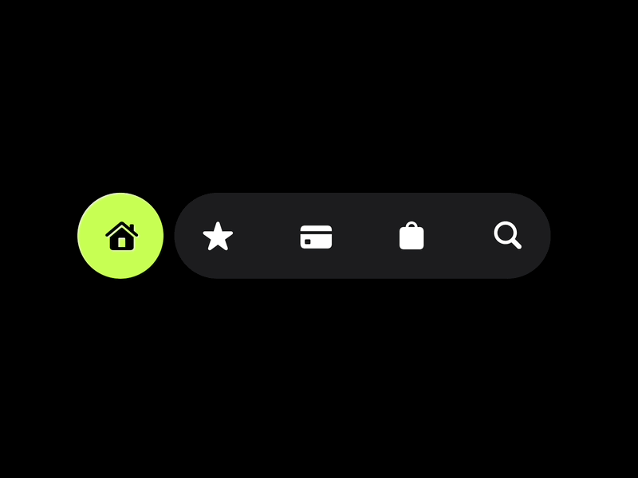

# Lime Home Circle Nav Bar Loop

**Discipline:** app · **Design type:** UI components
**Tags:** nav-bar, black, lime, pill, icons, minimal, animation

## What it is
A black field with a floating navigation made of a lime circular home button beside a dark grey pill of white star, card, bag and search icons, a frame from an animated interaction.

## What it means
The active item as a bright detached circle makes the state obvious and lends itself to a sliding animation.

## Techniques
- Active item in a separate lime circle
- Inactive items in one dark pill
- Solid white glyphs
- Pure black background
- Animation-ready structure

## Best for
- Navigation interaction studies
- Dark mode tab bars
- Single-accent UI

## Vocabulary
- **Detached active item** — A selected tab drawn as a separate shape from the bar.
- **Icon pill** — A capsule holding a row of icons.
- **Interaction study** — A small animated exploration of one component.
