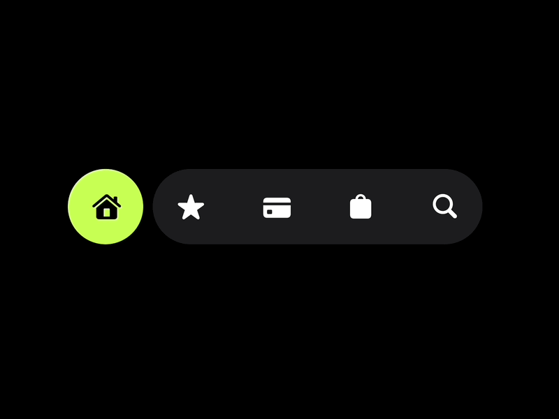

# Black Nav Bar with Lime Home Circle

**Discipline:** app ·  · **Design style:** Minimalist
**Tags:** nav-bar, black, lime, pill, icons, minimal, gif

## What it is
A black field with a floating navigation made of a lime circular home button beside a dark grey pill holding white star, card, bag and search icons.

## What it means
Separating the active item into its own lime circle makes the current location unmistakable, and a dark pill keeps the rest quiet.

## Techniques
- Active item in a separate lime circle
- Inactive items grouped in a dark pill
- Solid white glyph icons
- Pure black backdrop
- Very small component isolated for focus

## Best for
- Navigation component showcases
- Dark mode tab bars
- Single-accent UI

## Vocabulary
- **Detached active item** — A selected tab drawn as a separate shape from the bar.
- **Icon pill** — A capsule holding a row of icons.
- **Accent circle** — A coloured circle marking the active state.
