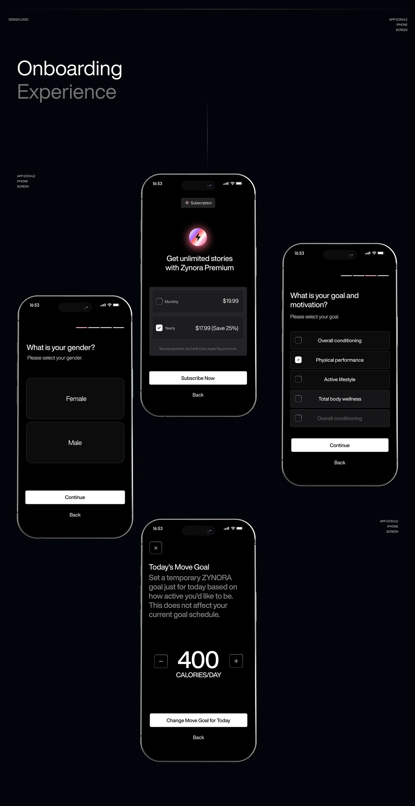

# Pure black onboarding flow with white selection cards and buttons

**Discipline:** app · **Design type:** Onboarding screens
**Tags:** onboarding, black, minimal, selection-cards, checkboxes, subscription, stepper, case-study

## What it is
A black case-study board headed 'Onboarding Experience' with staggered phones: a gender choice with two large dark cards, a goal picker with checkbox rows, a subscription paywall with a gradient orb icon and monthly/yearly options, and a numeric daily goal stepper. Every screen ends with a white full-width button and a plain Back link.

## What it means
Serious, focused and premium; removing colour makes every choice feel deliberate.

## Techniques
- Use only black, near-black and white with one single white primary button per screen.
- Show progress as a short segmented line at the top with one segment tinted.
- Make options large dark cards or rows with tiny checkboxes.
- Give the paywall one glowing gradient icon as its only colour.
- Stagger phones diagonally with tiny caption labels.

## Best for
- Fitness, wellness and subscription apps
- Dark-mode onboarding flows
- Case studies about flow logic

## Vocabulary
- **Segmented progress** — A short bar split into steps showing onboarding position.
- **Selection card** — A large tappable block representing one option.
- **Paywall** — A screen offering subscription plans.
- **Stepper** — A control with plus and minus buttons around a number.
