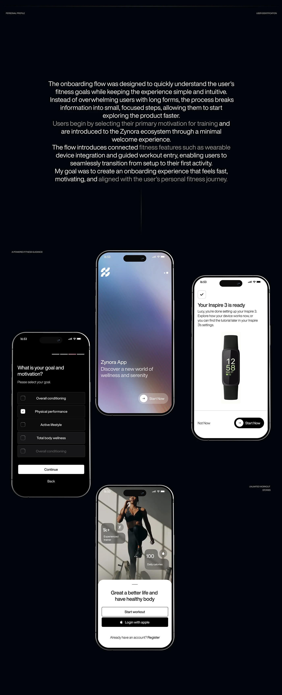

# Dark fitness onboarding: goal checklist, blurred violet welcome, tracker-ready and athlete sheet

**Discipline:** app ·  · **Design style:** Glassmorphism
**Tags:** onboarding, fitness, dark, gradient-blur, checklist, wearable, photo-sheet, case-study

## What it is
A black case-study board with a long centred paragraph (bright and dimmed text) and four phones: a black goal list with checkbox rows, a blurred violet-blue welcome, a white 'tracker is ready' screen with a band photo, and an athlete photo with a white bottom sheet and login buttons.

## What it means
Calm and motivating; each screen has a different mood but one clear action.

## Techniques
- Use a blurred gradient as a welcome screen.
- Show checklists as simple rows with one selected.
- Present a hardware pairing success screen.
- Use a photo header with a bottom sheet.

## Best for
- Fitness app onboarding
- Case studies with explanation text
- Wearable pairing flows

## Vocabulary
- **Blur welcome** — A screen with a soft blurred gradient.
- **Goal checklist** — A list of options with check boxes.
- **Pairing success** — A screen confirming a device is connected.
- **Bottom sheet** — A panel rising from the bottom.
