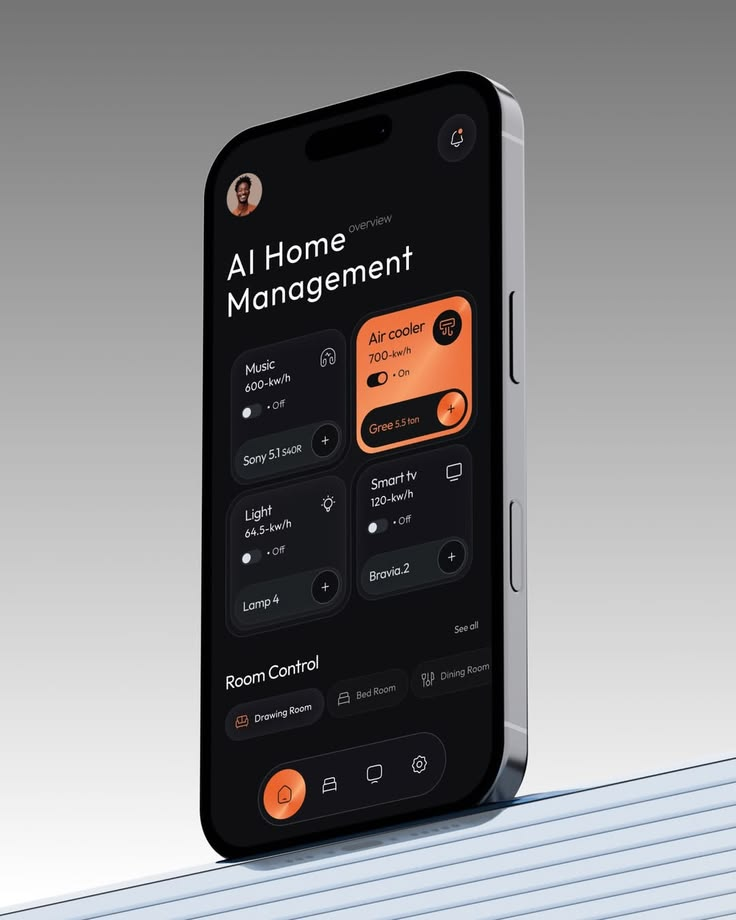

# Black and Orange Home Management Phone

**Discipline:** app · **Design type:** Device mockup scene
**Tags:** home-management, black, orange, glass-cards, ribbed, grey-gradient, toggles

## What it is
A tilted black phone on a pale ribbed ledge against a grey gradient, showing 'AI Home Management' with dark device cards and an orange metallic air cooler card, room tabs and a pill nav with an orange home button.

## What it means
Orange on black feels warm and premium, and one lit card shows which device is active.

## Techniques
- One orange card among dark cards
- Metallic orange gradient on buttons
- Pill nav with an orange active circle
- Ribbed ledge as a base
- Grey gradient studio backdrop

## Best for
- Smart-home and energy apps
- Dark UI product shots
- Single-accent dark interfaces

## Vocabulary
- **Active card** — The one card styled in the accent colour to show it is on.
- **Metallic gradient** — A gradient that imitates shiny metal.
- **Room tabs** — Pills for switching between rooms.
