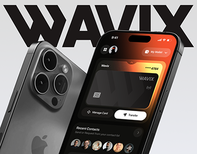

# Wallet Card Phone beside a Large Phone Back

**Discipline:** app ·  · **Design style:** Gradient & Aurora
**Tags:** wallet, black, orange, huge-wordmark, phone-back, glow, cover

## What it is
A cover with a huge black wordmark 'WAVIX' across the top, a large phone back with a triple camera at left and a phone at right showing a dark wallet screen with an orange glow, card, action buttons and contact avatars.

## What it means
A giant wordmark and phone back make a bold poster-like cover, and the orange glow makes the card feel alive.

## Techniques
- Giant black wordmark cropped by the frame
- Large device back as a graphic shape
- Orange glow inside the screen
- Pale grey backdrop for contrast
- Dark UI with white and orange buttons

## Best for
- Wallet and fintech covers
- Bold typographic device mockups
- Dark UI on light backdrops

## Vocabulary
- **Device back** — The rear of a phone shown as a graphic element.
- **Wordmark bar** — A brand name set enormous across the top of a cover.
- **Screen glow** — Coloured light emerging from the display.
