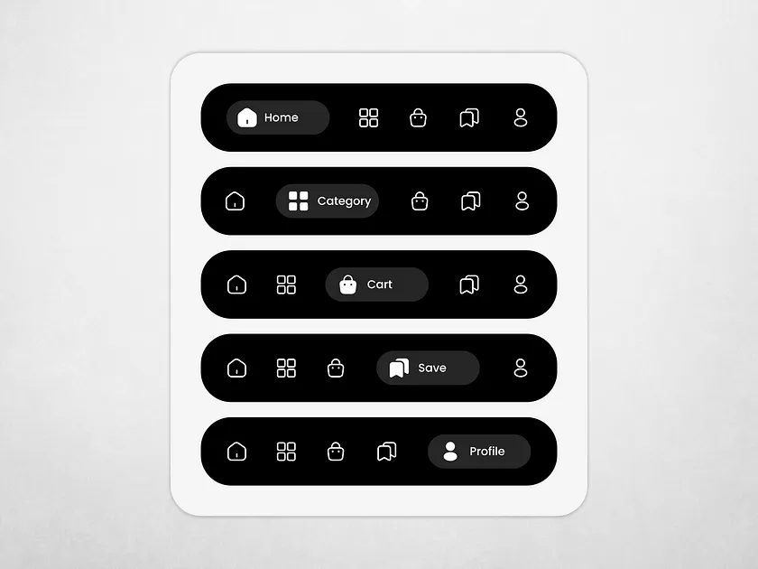

# Black Pill Tab Bar Active Label States

**Discipline:** app · **Design type:** UI components
**Tags:** tab-bar, black, white, pill, outline-icons, states, minimal

## What it is
A white rounded card on light grey holding five black pill bars, each with five outline icons where a different one is active as a dark grey pill with filled icon and label (Home, Category, Cart, Save, Profile).

## What it means
Stacking the five states shows the whole set at once, and white outline icons on black are crisp and legible.

## Techniques
- Active tab as a dark grey pill with a label
- Outline icons for inactive and filled for active
- Five states stacked in one card
- Black bars on a white card
- Consistent icon size and spacing

## Best for
- Tab bar state documentation
- Monochrome mobile navigation
- Component overview cards

## Vocabulary
- **Active label** — A text label shown only on the selected tab.
- **Outline icon** — An icon drawn with a thin stroke.
- **State stack** — Vertically listed versions showing each state.
