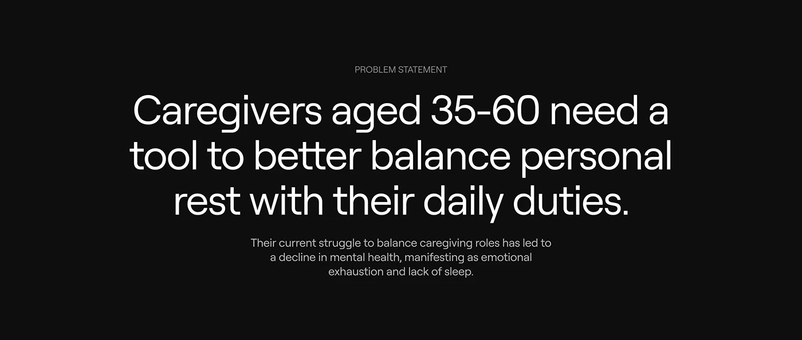

# Problem statement on pure black with one large light sans paragraph

**Discipline:** app ·  · **Design style:** Minimalist
**Tags:** case-study, problem-statement, black, white-type, centered, minimal, large-type

## What it is
A black slide with a small grey label 'PROBLEM STATEMENT', a huge centred three-line white sans statement about caregivers balancing rest, and a short grey paragraph beneath.

## What it means
Serious and clear; nothing competes with the sentence.

## Techniques
- Set the whole slide as one big statement.
- Use a tiny grey label above.
- Keep supporting text short and dimmer.
- Use black only.

## Best for
- Case-study problem slides
- Statement pages
- Dark minimal decks

## Vocabulary
- **Statement slide** — A slide built from one key sentence.
- **Eyebrow label** — A tiny caps label above a headline.
- **Tonal hierarchy** — White for primary, grey for secondary text.
- **Centred block** — Text centred on the canvas.
