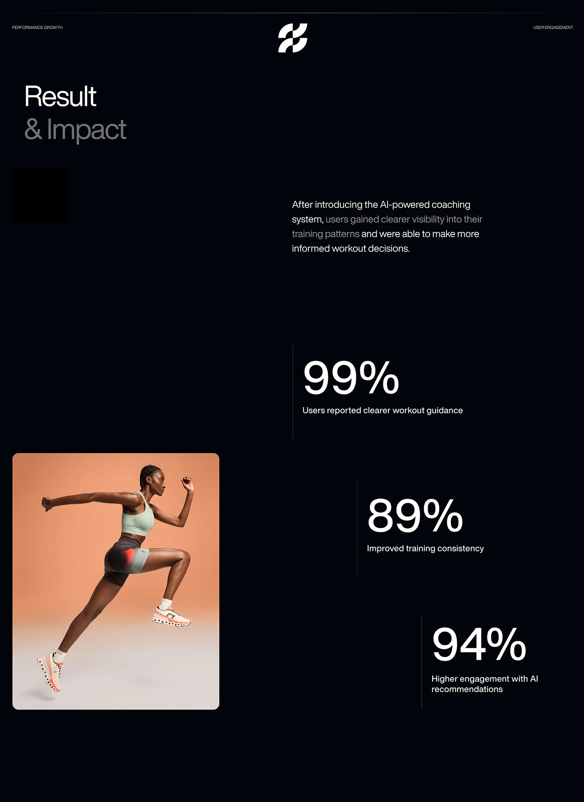

# Black 'Result & Impact' page with three staggered giant thin percentages and a rounded athlete photo

**Discipline:** app ·  · **Design style:** Dark & Neon
**Tags:** results, dark, stats, thin-type, athlete, peach, stagger, case-study

## What it is
A near-black page with a header of small corner labels and a white logo mark, a large two-tone title 'Result & Impact', a paragraph with dimmed phrases, three huge thin percentages (99%, 89%, 94%) on vertical hairlines stepping down and right, and a rounded photo of a running athlete on a peach backdrop with a red hotspot on the thigh at the left.

## What it means
Clear and energetic; staggered giant numerals steer the eye while the peach photo adds warmth to black.

## Techniques
- Step giant thin numerals diagonally with hairlines.
- Use a single warm photo on a dark page.
- Dim part of the paragraph.
- Add a small hotspot on the photo.

## Best for
- Results and impact slides
- Fitness and AI coaching case studies
- Dark stat pages

## Vocabulary
- **Staggered stats** — Big figures offset in a diagonal.
- **Hairline marker** — A thin vertical line beside a stat.
- **Photo hotspot** — A glowing spot on a photo showing data.
- **Two-tone title** — A title with the second line dimmed.
