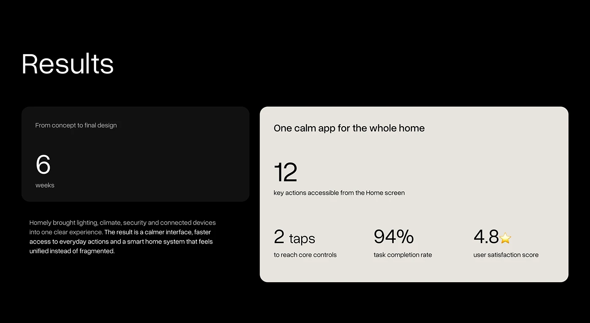

# Black Results Slide with Cream Stats Card

**Discipline:** app ·  · **Design style:** Warm & Organic
**Tags:** results, black, cream, stats, numbers, minimal, smart-home

## What it is
A black slide titled Results with a dark card showing 6 weeks concept to final design, a paragraph in white and grey, and a large cream card with 12 key actions on the home screen, and stats for 2 taps, 94% completion and 4.8 satisfaction.

## What it means
Big light numerals on black and cream make results calm and legible, and a cream card lifts the key claims.

## Techniques
- Large light numerals as the stats
- Dark card and light card in contrast
- Paragraph with bright key sentence
- Small captions under each number
- Ample empty space

## Best for
- Results slides
- Smart-home and product case studies
- Stat-led closing slides

## Vocabulary
- **Stat trio** — Three key numbers with short captions in a row.
- **Contrast cards** — A dark card and a light card set side by side.
- **Results slide** — A slide summarising outcomes of a project.
