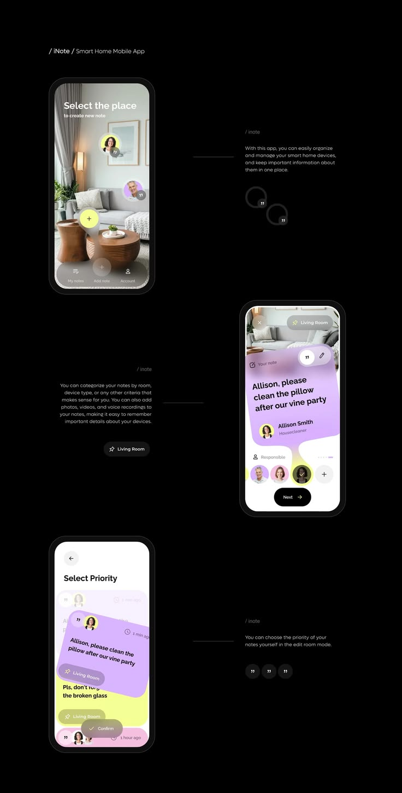

# Black Smart-Home Notes App Flow

**Discipline:** app · **Design type:** Onboarding screens
**Tags:** black, notes, smart-home, lavender, yellow, flow, captions

## What it is
A black page of three phones stepping down the page (choose a room, write a note on a lilac card, set priority) with thin lines to tiny captions and round quote icons.

## What it means
The staggered phones and hairline captions tell a story on black, and lilac and yellow notes feel playful.

## Techniques
- Phones zigzagging down the page
- Hairline leader lines to captions
- Room photo as a tappable canvas
- Organic lilac note card with a tail
- Round icon chips as decorative repeats

## Best for
- App flow presentations
- Dark storytelling boards
- Note and task apps

## Vocabulary
- **Zigzag layout** — Items alternating left and right down the page.
- **Leader line** — A thin line linking an image to its caption.
- **Note card** — A coloured card representing a user note.
