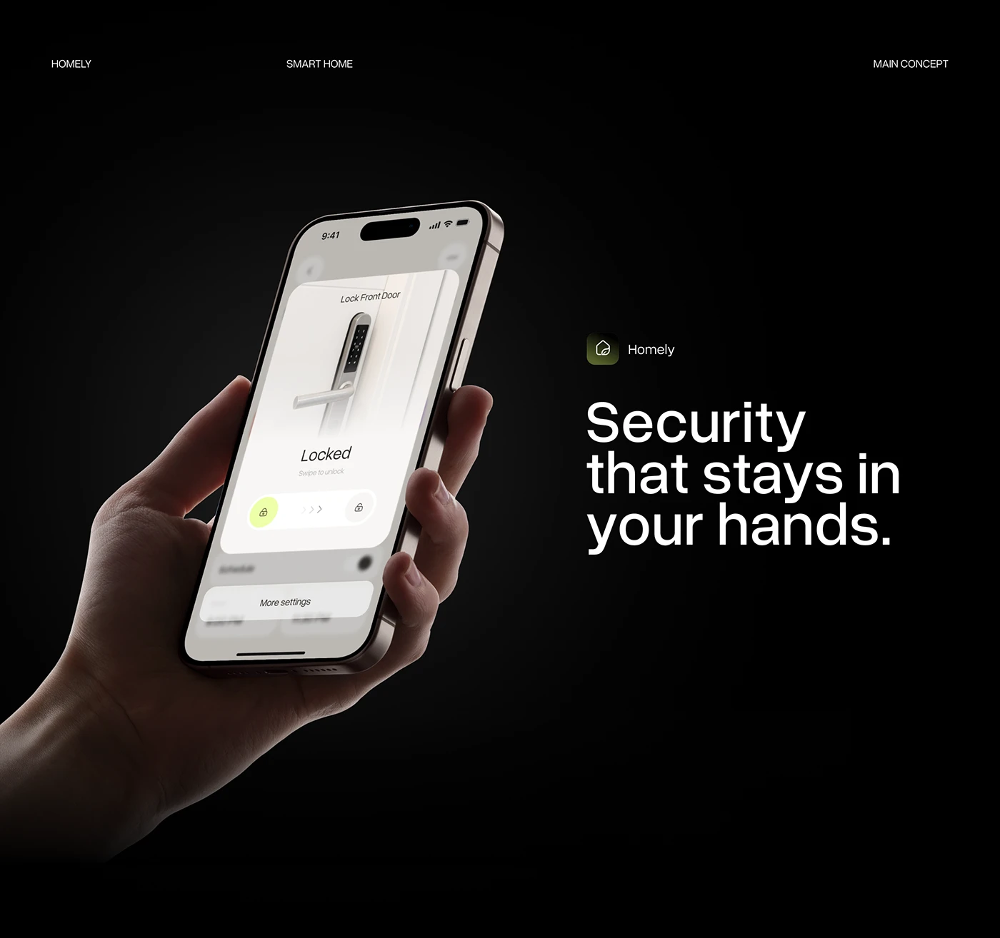

# Smart Lock Screen in a Lit Hand

**Discipline:** app ·  · **Design style:** Minimalist
**Tags:** black, smart-lock, hand, headline, cream, security, minimal

## What it is
A black slide with a hand holding a phone showing a cream smart-lock screen with 'Locked' and a swipe control, beside a logo lockup and the headline 'Security that stays in your hands.'

## What it means
The lit hand and headline echo each other, and a pale UI on black makes the screen the hero.

## Techniques
- Hand lit from one side against pure black
- Headline that puns on the image
- Small nav labels across the top
- Swipe-to-unlock as the focal interaction
- Logo lockup above the headline

## Best for
- Smart-home security concepts
- Dark presentation slides
- Text-and-device layouts

## Vocabulary
- **Concept headline** — A line whose meaning matches the picture.
- **Swipe control** — A slider that completes an action when dragged.
- **Header labels** — Small caps labels at the top of a slide.
