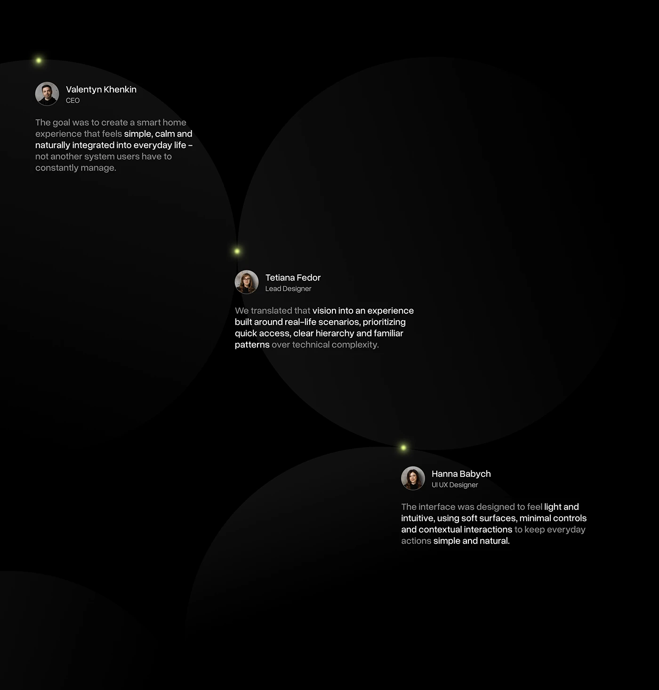

# Black Team Quotes on Dark Circles

**Discipline:** app ·  · **Design style:** Gradient & Aurora
**Tags:** quotes, team, black, circles, glow, avatars, minimal

## What it is
A black slide with three huge barely visible dark circles, each holding a team member's avatar, name, role and quote with a few phrases in white and the rest grey, anchored by small lime glow points.

## What it means
Almost invisible circles group content softly, and lime glow dots add a sense of connection between voices.

## Techniques
- Ultra-low-contrast circles as containers
- Highlight key phrases in white within grey text
- Glow dots at circle contacts as connectors
- Staggered placement down the page
- Small avatar with name and role above each quote

## Best for
- Team quotes in case studies
- Dark testimonial layouts
- Storytelling with several voices

## Vocabulary
- **Ghost container** — A container so subtle it barely separates content from the background.
- **Phrase highlight** — Making selected words brighter than the rest.
- **Glow point** — A small luminous dot used as a connector or marker.
