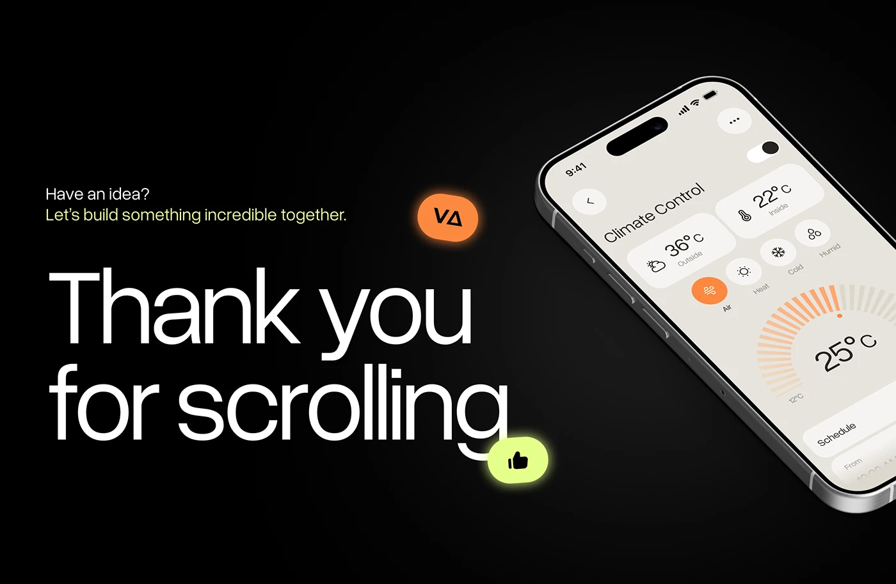

# Thank You for Scrolling Closing Slide

**Discipline:** app · **Design type:** Case study closing slide
**Tags:** closing, black, thanks, orange, lime, phone, thumbs-up

## What it is
A black closing slide with a huge white 'Thank you for scrolling' headline, a lime-tinted invitation line, an orange logo pill, a lime thumbs-up bubble and a tilted phone showing a cream climate-control screen.

## What it means
Big friendly type ends a case study with warmth, and glowing pills add playful sign-off energy.

## Techniques
- Oversized lightweight headline as the main graphic
- Glowing pill stickers (logo, thumbs-up) overlapping the text
- Phone cropped off the right edge at an angle
- Lime accent line inviting contact
- Deep black with subtle radial lift

## Best for
- Case study endings
- Portfolio sign-offs
- Contact and hiring calls to action

## Vocabulary
- **Sign-off slide** — The final slide thanking viewers and inviting contact.
- **Glow pill** — A rounded label with a soft coloured glow.
- **Cropped device** — A device cut off by the frame edge.
