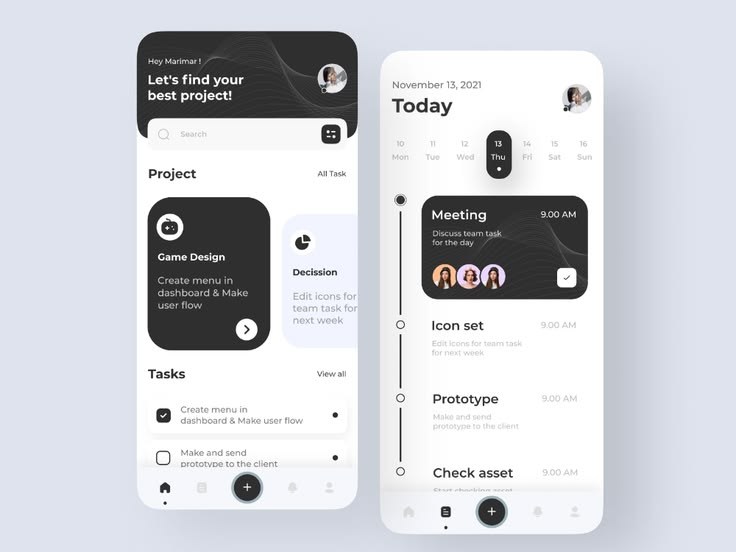

# Black and White Task App Two Screens

**Discipline:** app · **Design type:** Calendar and planner app
**Tags:** tasks, black, white, timeline, cards, waves, planner

## What it is
Two phones on lavender grey: a home with a black header with wave lines, dark and pale project cards and a task list, and a Today screen with a date strip and a black vertical timeline with a meeting card.

## What it means
Monochrome cards with subtle line art feel focused and professional, and the vertical timeline shows the day at a glance.

## Techniques
- Black cards among white for priority
- Wave line texture on dark areas
- Selected date as a black pill
- Vertical timeline with node dots
- Floating round plus button in the nav

## Best for
- Task and project planners
- Monochrome app UI
- Timeline day views

## Vocabulary
- **Date strip** — A row of days with the current one highlighted.
- **Timeline node** — A dot on a vertical line marking an event.
- **Wave texture** — Flowing line art used as a subtle pattern.
